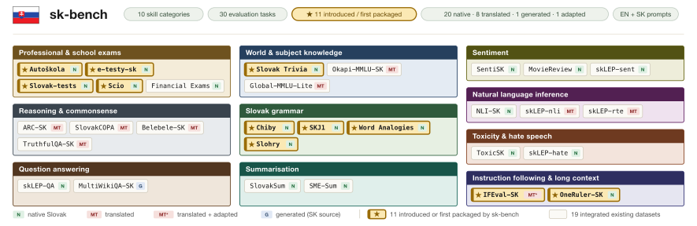

# 🇸🇰 sk-Bench

### *Bringing Precision to Slovak Language Model Evaluation*

`sk-bench` is a specialized benchmarking engine for measuring and refining the performance of Large Language Models (LLMs) in the Slovak language. Powered by the [lighteval](https://github.com/huggingface/lighteval) framework, it provides a robust, reproducible infrastructure for linguistic validation across open-source and closed-source models.

🏆 **[Explore the live sk-bench Leaderboard →](https://huggingface.co/spaces/slovak-nlp/sk-bench-leaderboard)**

## 🚀 Overview

Multilingual LLM benchmarks tend to omit Slovak — a morphologically rich West Slavic language of roughly five million speakers — or cover it only through machine translation, which inherits source-language bias and leaves exploitable translation artifacts in the data. `sk-bench` is a **native-first** Slovak benchmark that addresses this gap: **30 datasets (33 scored task variants) across ten skill categories**, run under a single generate-and-match harness against **55 open- and closed-weights models** to produce zero-shot, identically-prompted, side-by-side Slovak scores.



Its organising principle is a **paired provenance contrast**: wherever possible the same skill is measured from native, machine-translated, and LLM-generated data, so provenance can be varied while the skill is held fixed. Twelve of the 30 tasks (40%) did not exist as LLM evaluations before `sk-bench`, including IFEval-SK (verifiable instruction following with re-implemented Slovak checkers) and the Chiby/SKJ1 grammaticality probes — constructs no translated benchmark can produce.

## ✨ Key Features

- **🇸🇰 Native-First**: Native Slovak data is preferred over translation; translated proxies are admitted only where no native equivalent exists for a skill. Captures the morphology, syntax, and cultural context of Slovak.
- **📚 Broad Coverage**: 30 datasets / 33 scored task variants across ten skill categories — classification, reading, knowledge, generation/summarisation, instruction following, grammar & morphology, long-context retrieval, and more.
- **🆕 New Slovak Resources**: 12 datasets introduced or first wrapped for generative-LLM evaluation, including IFEval-SK and the native Chiby/SKJ1 grammar and morphology probes.
- **⚡ Lighteval Engine**: Built on Hugging Face's `lighteval`, with one generate-and-match pipeline so no scoring asymmetry confounds open-vs-closed comparisons.
- **🔄 Multi-Provider Support**: Evaluate open-weights models (via vLLM) and closed-source models (OpenAI, Anthropic, Gemini, and more via LiteLLM) under identical prompts and per-task token budgets.
- **📊 Standardized Metrics**: Accuracy, quasi-exact-match / quasi-F1 for QA, ROUGE / chrF / METEOR for summarisation, and strict/loose instruction-following accuracy — aggregated in the spirit of GLUE/SuperGLUE.
- **🛠️ Built for Growth**: A modular registry-based design that lets researchers plug in new datasets, prompts, and custom metrics (see [CONTRIBUTING.md](CONTRIBUTING.md)).
- **🐳 Containerized Execution**: Reproducible runs using Apptainer/Singularity containers for HPC clusters (Perun, Devana).

## 🛠️ Quick Start

**Requirements:** Python ≥ 3.10, [`uv`](https://docs.astral.sh/uv/). A CUDA GPU is needed for local vLLM runs.

```bash
git clone https://github.com/slovak-nlp/sk-bench.git
cd sk-bench
uv sync
```

For API models, set up API keys first:

```bash
cp .env.example .env
# Edit .env with your keys — see Environment Variables below
```

---

## 🚀 Running Evaluations

Pick the path that matches your model:

| Model type | Script |
|---|---|
| 🟢 Open-source (local GPU) | `eval_vllm.py` |
| 🔵 API / closed-source | `eval_litellm.py` |
| 🟠 HPC cluster (SLURM) | [`container/slurm/`](container/slurm/README.md) |

### 🟢 Open-Source Models (vLLM)

```bash
uv run python eval_vllm.py \
    --model-name Qwen/Qwen3-0.6B \
    --tasks-file tasks_list_zero.txt \
    --tensor-parallel-size 1
```

Swap `--model-name` for any open-source model and `--tasks-file` for your task list to run a different model.

### 🔵 API Models (LiteLLM)

```bash
export API_KEY="sk-..."   # your provider key

uv run python eval_litellm.py \
    --model-name openai/gpt-5.5 \
    --tasks-file tasks_list_zero.txt
```

### 🟠 HPC / SLURM

For running on the Perun or Devana clusters, see [`container/slurm/README.md`](container/slurm/README.md).

---

## 📋 Tasks

Tasks are listed one per line in text files (`#` comments are ignored):

- `task_name` — run a task (zero-shot)
- `task_name|N` — run with `N` few-shot examples
- `task_name:subset` — run a subset of a task

```txt
belebele.prompt1_mqa_single_correct_sk|0
arc.prompt1_mqa_single_correct_sk|0
mmlu.prompt1_mqa_single_correct_sk:abstract_algebra|0
```

**Available task files:**

| File | Contents |
|---|---|
| [`all_tasks.txt`](all_tasks.txt) | All available tasks |
| [`tasks_list_zero.txt`](tasks_list_zero.txt) | Zero-shot tasks |
| [`tasks_list_few.txt`](tasks_list_few.txt) | Few-shot tasks |

List all tasks:

```bash
uv run python -m list_tasks
```

Tasks come from [`slovak-nlp/sklep`](https://huggingface.co/datasets/slovak-nlp/sklep), external Hugging Face datasets, and custom implementations in `src/tasks/`. See the full [sk-bench collection on Hugging Face](https://huggingface.co/collections/slovak-nlp/sk-bench).

> **📚 Citing datasets:** When using `sk-bench`, please also cite the individual datasets used for benchmarking (each task's source dataset may have its own citation — see the task implementations in `src/tasks/`).

---

## 📊 Output

Results are written to `outputs/` by default (override with `--output-dir`). Pass `--save-details` to also save per-sample results under `outputs/details/<model>/` for later re-scoring and re-analysis.

## ⚙️ Environment Variables

| Variable | Purpose |
|---|---|
| `OPENAI_API_KEY` | OpenAI API key |
| `OPENAI_BASE_URL` | Custom endpoint (optional, self-hosted APIs) |
| `ANTHROPIC_API_KEY` | Anthropic API key |
| `GEMINI_API_KEY` | Google Gemini API key |
| `API_KEY` | Generic API key used by `eval_litellm.py` |

---

## 🏗️ Development

```bash
uv sync --all-groups
uv run pre-commit install
uv run pre-commit run --all-files
```

## 📜 Contributing

See [CONTRIBUTING.md](CONTRIBUTING.md) for adding tasks, creating prompts, and testing changes.

## 📚 Citation

If you use `sk-bench` in your work, please cite our paper ([arXiv:2610.09152](https://arxiv.org/abs/2610.09152)):

```bibtex
@misc{šuppa2026skbenchnativefirstbenchmarkevaluating,
      title={sk-bench: A Native-First Benchmark for Evaluating Large Language Models in Slovak}, 
      author={Marek Šuppa and Ivan Vykopal and Andrej Ridzik and Kristián Sopkovič and Natália Kňažeková and Jaroslav Kopčan and Miroslav Blšták and Viktória Ondrejová and Daniel Hládek and Michal Gregor and Martin Tamajka and Marián Šimko},
      year={2026},
      eprint={2610.09152},
      archivePrefix={arXiv},
      primaryClass={cs.CL},
      url={https://arxiv.org/abs/2610.09152}, 
}
```

## 📜 License

Apache License 2.0 — see [LICENSE](LICENSE).
